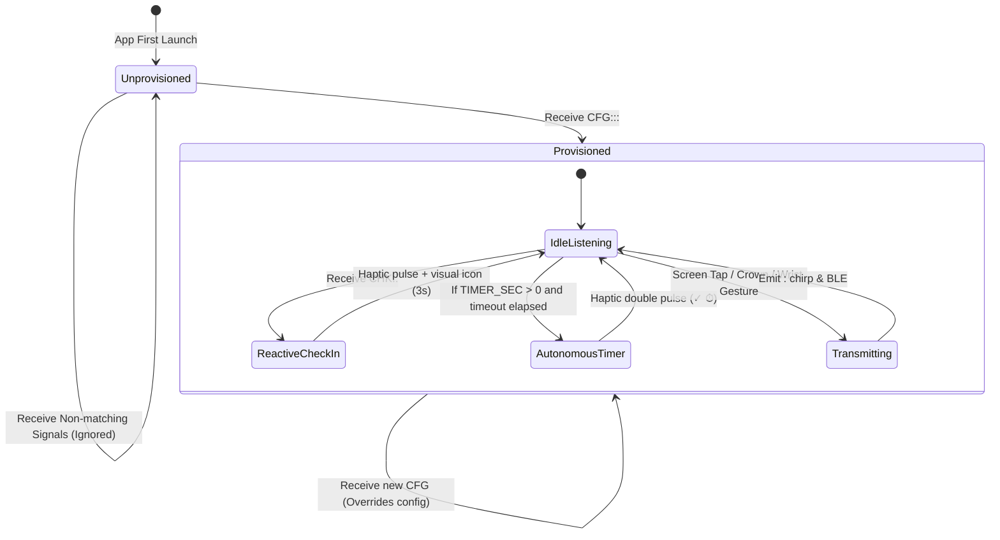

# GibberLink Protocol & Provisioning Specification
**Target Systems:** GibberWear (Wear OS Smartwatch) $\leftrightarrow$ Muse (Companion App / Web Client)  
**Document Version:** 1.0  
**Status:** Draft for Coordination & Implementation Alignment  

---

## 1. Executive Summary & Objectives

The goal of this revision is to transition **GibberWear** from an un-attributed, broadcast-only utility into a **bi-directionally provisionable, multi-tenant wearable terminal**.

### Key System Principles:
1. **Primary Transport:** **GibberLink (Acoustic / GGWave Ultrasound)** is the primary communication channel.
2. **Fallback Transport:** **Bluetooth Low Energy (BLE)** mirrors all GibberLink protocol formats 1:1.
3. **No Hardcoded Autonomous Defaults:** The watch must **not** default to an autonomous 5-minute reminder loop. Check-in reminders are primarily initiated remotely by Muse, or governed by explicitly provisioned local timer intervals.
4. **Attributed Telemetry:** All telemetry emitted by the watch must carry a provisioned **User Identifier (`UID`)** so Muse can distinguish multiple senders in the same acoustic space.
5. **On-Watch Provisioning:** The watch receives its `UID`, display name, and operational timer parameters via a setup handshake over GibberLink or BLE.

---

## 2. Message Format & Protocol Payloads

Acoustic ultrasound transmission via GGWave (Fast Ultrasound protocol, 48 kHz mono) operates with limited payload bandwidth (typically 8–16 bytes per burst). All payloads must remain compact, ASCII-encoded, and delimiter-separated (`:`).

### A. Telemetry Payloads (Watch $\rightarrow$ Muse)

All transmissions from the watch must prepend the provisioned `UID`.

#### 1. Instant Touch & Motion Gestures
Format: `<UID>:<GESTURE>`

| Gesture Trigger | Payload Example (`UID=J1`) | Meaning |
| :--- | :--- | :--- |
| **Tap** (Center touch or wrist shake) | `J1:TAP` | Primary confirmation / check-in acknowledge |
| **Double Tap** (Center or wrist flip) | `J1:DBL` | Secondary signal |
| **Hold** (Long press or sustained shake) | `J1:HLD` | Hold / stop / alert |

#### 2. Continuous Metric State Tracking
Format: `<UID>:<METRIC><VALUE>`  
*Values are quantized to 10s between `-100` and `+100` (or `0` to `100`), where `+` can be omitted or explicit.*

| Metric Dimension | Key | Payload Example (`UID=J1`) | Notes |
| :--- | :--- | :--- | :--- |
| **Enjoyment** | `E` | `J1:E80` or `J1:E-20` | Outer ring arc |
| **Heat / Intensity** | `H` | `J1:H60` | Middle ring arc |
| **Endurance / Capacity** | `N` | `J1:N40` | Inner ring arc |

---

### B. Remote Control & Check-In Signals (Muse $\rightarrow$ Watch)

Muse sends signals to initiate physical check-ins on the wearer.

Format: `CHK:<TARGET_UID>:<TYPE>`

| Field | Values | Description |
| :--- | :--- | :--- |
| `TARGET_UID` | Alphanumeric (e.g. `J1`, `01`, `ALL`) | Only the matching watch responds (`ALL` for broadcast). |
| `TYPE` | `P` (Pulse) | Single gentle haptic vibration pulse (150ms) + display `✓ ♥`. |
| `TYPE` | `T` (Timer) | Double haptic vibration pulse (100ms / 100ms) + display `✓ ⏱`. |

*Examples:*
- `CHK:J1:P` $\rightarrow$ Watch `J1` vibrates once with heart symbol.
- `CHK:J1:T` $\rightarrow$ Watch `J1` vibrates twice with timer symbol.
- `CHK:ALL:T` $\rightarrow$ All nearby provisioned watches trigger double check-in.

---

### C. Device Provisioning / Programming Setup (Muse $\rightarrow$ Watch)

Used during initial onboarding or pairing to configure the watch without physical UI entry.

Format: `CFG:<UID>:<DISPLAY_NAME>:<TIMER_SEC>`

| Parameter | Type / Constraints | Description |
| :--- | :--- | :--- |
| `<UID>` | 1–4 Alphanumeric characters | Unique short identifier (e.g. `A1`, `SUB1`, `04`). |
| `<DISPLAY_NAME>` | 1–10 ASCII characters | Display name shown on the watch face (e.g. `Jason`, `Alex`). |
| `<TIMER_SEC>` | Integer (Seconds) | **`0`** = **Disabled** (Watch strictly relies on external signals).<br>**`> 0`** = Autonomous fallback reminder interval (e.g. `300` = 5 min). |

*Examples:*
- `CFG:J1:Jason:0` $\rightarrow$ Sets ID to `J1`, name to `Jason`, **disables** autonomous timer (purely reactive).
- `CFG:A2:Sam:600` $\rightarrow$ Sets ID to `A2`, name to `Sam`, activates a 10-minute local reminder timer.

#### Provisioning Handshake Acknowledgment (Watch $\rightarrow$ Muse)
When the watch successfully parses and persists the `CFG` message, it immediately emits:
```text
ACK:<UID>:CFG
```
*(e.g., `ACK:J1:CFG`)*, allowing Muse to confirm that programming succeeded.

---

## 3. Watch Runtime Behavior & State Machine



### Persistence
- Configuration parameters (`UID`, `displayName`, `timerSec`) must be stored in on-device persistent storage (`SharedPreferences` or `EncryptedSharedPreferences`).
- App cold-starts retain the last provisioned configuration.

---

## 4. Multi-Channel Transport Architecture

### Channel 1: GibberLink Ultrasound (Primary)
- **Protocol:** GGWave Audio (Fast Ultrasound mode, center carrier frequency ~18–20 kHz).
- **Sampling Rate:** 48 kHz mono.
- **Hardware Requirements:**
  - Watch Speaker for transmission.
  - Watch Microphone (`android.permission.RECORD_AUDIO`) active in foreground for listening.

### Channel 2: Bluetooth Low Energy (Fallback & Redundancy)
- **Service UUID:** `0000FFF0-0000-1000-8000-00805F9B34FB` (GibberLink BLE Service)
- **Characteristics:**
  - **Telemetry TX (Notify):** Emits outgoing attributed payloads (`J1:TAP`, `J1:E80`).
  - **Control RX (Write):** Accepts incoming commands (`CFG:...`, `CHK:...`).
- Payload parsing logic is identical between GibberLink and BLE.

---

## 5. Coordination & Alignment Checklist for Muse

Before finalizing implementation, please confirm the following protocol details:

1. [ ] **UID Character Set & Length:** Confirm whether `1–4` alphanumeric characters (e.g. `[A-Za-z0-9]{1,4}`) is sufficient for your database schema.
2. [ ] **Display Name Length:** Confirm maximum length (recommended: max 8–10 characters to fit cleanly above Wear OS dial rings).
3. [ ] **Acoustic Synthesis on Watch:** 
   - *Option A (Recommended):* Embed GGWave native C++ library via NDK on the watch to synthesize dynamic `<UID>:...` WAV audio in real time.
   - *Option B:* Muse sends pre-computed sound tokens or restricts UIDs to a fixed static table.
4. [ ] **Microphone Duty-Cycle:** Does Muse expect the watch to continuously listen in the foreground, or only during active sessions / pairing modes to preserve watch battery?
5. [ ] **Confirmation Handshake:** Confirm if Muse expects `ACK:<UID>:CFG` ultrasonic chirp response upon provisioning completion.
