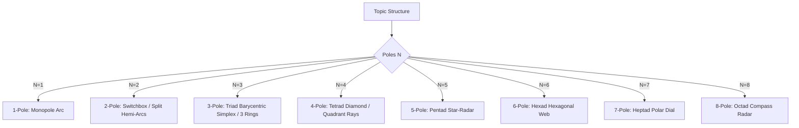

# GibberWear N-Pole Ratings Widget Specification & Choreography Protocol
**Target Platforms:** GibberWear (Wear OS Smartwatch Client) $\longleftrightarrow$ Muse / Sexcapades-Web (Host & Scene Sentinel)  
**System Reference:** Flexcapades Engine & GibberLink Protocol Suite  
**Document Version:** 1.0  
**Status:** Engineering & UI/UX Architecture Specification  

---

## 1. Executive Summary & Purpose

This document specifies the complete visual, interaction, and communication architecture for **GibberWear's N-Pole Ratings Widgets** on circular Wear OS smartwatches. It establishes:

1. **The 1–3 Concentric Slider Mode for Standard Topics**: Preserving the 1–3 concentric dial rings ($E, H, N$) as multi-ring arc sliders on circular watch faces.
2. **N-Pole Rating Widgets (1 through 8 Poles)**: Full geometric definitions, touch zones, rotary crown bindings, and normalization schemes for simplexes, switchboxes, triangles, diamonds, stars, and radar dials spanning 1 to 8 poles.
3. **Draft Mode & Physical Wrist Roll Submission**: Because setting multi-pole configurations on a compact watch face requires multiple taps, drags, or crown adjustments, ratings remain in a visual **Draft State** until committed via an intentional **Physical Wrist Roll** gesture (measured by the 6-axis IMU). This prevents accidental, premature transmissions.
4. **Over-The-Air Programming & Choreography (BLE & GibberLink Acoustic)**: A lightweight ASCII protocol enabling Muse / Scene Sentinel to dynamically trigger real-time rating prompts, pre-load timed scene choreographies, and broadcast periodic high-precision time-synchronization pulses.

---

## 2. Hardware Environment & Form Factor

GibberWear is engineered for circular Wear OS smartwatches (e.g., Pixel Watch 1/2/3, Galaxy Watch 4/5/6/7) with the following hardware specifications:

- **Display**: Circular AMOLED, $384\times 384$ to $454\times 454$ px (effective active diameter $\approx 1.2$–$1.4$ inches).
- **Input Modalities**:
  - Capacitive multi-touch surface (tap, drag, radial scrub).
  - Rotary Crown with fine hardware detent events (`RotaryScrollEvent`).
  - Physical side button / stem button.
  - 6-Axis Inertial Measurement Unit (IMU): 3-axis accelerometer + 3-axis gyroscope operating at $\ge 50\text{ Hz}$.
- **Transports**:
  - **GibberLink Acoustic (Primary)**: GGWave Fast Ultrasound ($18.5$–$20.0\text{ kHz}$, $48\text{ kHz}$ mono audio pipeline, volume $\ge 70$, range $2$–$5\text{ m}$).
  - **Bluetooth Low Energy (Fallback & Mirror)**: Custom GATT Service `0000FFF0-0000-1000-8000-00805F9B34FB`.

---

## 3. The 1–3 Ring Radial Slider Mode (Standard Topics)

For standard Sexcapades / Flexcapades topics (1-pole monopole, 2-pole give/receive, and 3-pole triad topics), GibberWear renders **1 to 3 concentric circular arc sliders** directly inscribed within the round bezel.

```
                  [ 12:00 ]
             .----------------.
          .-'      HEAT        '-.
        .'    .--------------.    '.
       /     /  GIVE / ENJOY  \     \
      |     |   .----------.   |     |
      |     |  |  RECEIVE   |  |     |
      |     |  |   [+80]    |  |     |   <-- Rotary Crown
      |     |   '----------'   |     |       adjusts focused ring
       \     \                /     /
        '.    '--------------'    .'
          '-.                  .-'
             '----------------'
                  [  6:00  ]
```

### 3.1 Ring Allocations & Geometry
On a standard $454\times 454$ display (center $X=227, Y=227$):

| Ring | Dimension / Metric | Radius ($R$) | Stroke Width | Sweep Arc | Default Color |
| :--- | :--- | :--- | :--- | :--- | :--- |
| **Ring 1 (Outer)** | **Give / Enjoyment ($E$)** | $210\text{ px}$ | $14\text{ px}$ | $270^\circ$ ($-135^\circ$ to $+135^\circ$) | Hanky / Active Theme |
| **Ring 2 (Middle)** | **Heat / Intensity ($H$)** | $184\text{ px}$ | $12\text{ px}$ | $270^\circ$ ($-135^\circ$ to $+135^\circ$) | Heat Amber / Red (`zi(H)`) |
| **Ring 3 (Inner)** | **Receive / Capacity ($N$)** | $160\text{ px}$ | $10\text{ px}$ | $270^\circ$ ($-135^\circ$ to $+135^\circ$) | Contrast Accent (`zi(N)`) |

*Note: For single-metric topics, Rings 2 and 3 are hidden; Ring 1 expands to $18\text{ px}$ thickness. For 2-pole topics, Ring 3 is omitted.*

### 3.2 Interaction Model
1. **Focus Selection**: Tapping anywhere on a ring's annular track selects it. The selected ring brightens with an outer glow; non-focused rings dim to $40\%$ opacity. A subtle haptic tick confirms selection.
2. **Radial Scrubbing**: Dragging a finger along the arc smoothly sweeps the thumb indicator and updates the value continuously in real-time.
3. **Rotary Crown Fine-Tuning**: Rotating the watch crown increments or decrements the active focused ring in discrete $5\%$ steps (or $1$ integer unit on $-100 \dots +100$ scales), firing a calibrated haptic detent tick per step.
4. **Readout Disc**: The center disc ($R \le 120\text{ px}$) displays the active metric label, numerical value, and the topic's glyph/icon.

---

## 4. Comprehensive N-Pole Ratings Widgets (1 to 8 Poles)

GibberWear implements native Wear OS rendering for all 8 n-pole topic structures. Each widget adapts the multi-pole simplex geometry to circular watch constraints.



---

### 4.1 1-Pole: Monopole Widget (`W1_MONO`)
- **Use Case**: Scalar topics, pure interest/intensity, single acceptance threshold (0–100% or $-100 \dots +100$).
- **Geometry**: Single $270^\circ$ circular progress arc hugging the outer bezel from $135^\circ$ to $405^\circ$.
- **Controls**:
  - Direct touch sweep along the bezel.
  - Crown rotation directly moves the cursor with haptic clicks.
- **Center Disc**: Large percentage/value text with topic icon and descriptive label below.

---

### 4.2 2-Pole: Switchbox / Dyad Widget (`W2_SWITCHBOX`)
- **Use Case**: Bipolar topics (Give vs. Receive, Dominant vs. Submissive, Top vs. Bottom, Pure vs. Applied).
- **Geometry**:
  - **Layout A (Dual Concentric Arcs)**: Ring 1 = Pole A, Ring 2 = Pole B.
  - **Layout B (Split Hemi-Arcs)**: Top hemi-circle ($-45^\circ \dots 225^\circ$) = Pole A; Bottom hemi-circle ($135^\circ \dots 315^\circ$) = Pole B.
- **Controls**:
  - Tap Top or Bottom half to focus Pole A or Pole B.
  - Crown dials the focused pole.
  - Long press switches between independent dual-slider mode and antagonistic seesaw mode ($P_B = 100 - P_A$).

---

### 4.3 3-Pole: Triad Widget (`W3_TRIAD`)
- **Use Case**: Trilinear topics, barycentric simplexes (e.g., Physical / Emotional / Cerebral, or Sensation / Dominance / Submission).
- **Geometry**:
  - **Dual Mode Affordance**:
    - **Mode 1 (3 Concentric Rings)**: Outer, middle, and inner rings mapping Poles 1, 2, and 3 respectively.
    - **Mode 2 (Barycentric Inscribed Simplex)**: An equilateral triangle centered at $(X_0, Y_0)$ with vertices at:
      - $V_1$: $0^\circ$ (Top, $12:00$)
      - $V_2$: $120^\circ$ (Bottom-Right, $4:00$)
      - $V_3$: $240^\circ$ (Bottom-Left, $8:00$)
  - A draggable barycentric puck $\mathbf{P} = w_1 V_1 + w_2 V_2 + w_3 V_3$ where $\sum w_i = 1.0$.
- **Controls**:
  - In Mode 2, touching any point inside the triangle immediately positions the puck.
  - Crown fine-tunes along the dominant vertex altitude.
  - Double-tap center toggles between 3-Ring mode and Barycentric Simplex mode.

---

### 4.4 4-Pole: Tetrad Widget (`W4_TETRAD`)
- **Use Case**: 4-pole diamond taxonomies (e.g., Compass axes: Physical, Psychological, Social, Spiritual).
- **Geometry**:
  - Diamond polygon with 4 cardinal vertex handles:
    - North ($0^\circ, 12:00$)
    - East ($90^\circ, 3:00$)
    - South ($180^\circ, 6:00$)
    - West ($270^\circ, 9:00$)
  - Inner fill: Translucent quad polygon whose vertices deform along each radial ray according to pole intensity ($0 \dots 100\%$).
- **Controls**:
  - Direct touch on a quadrant or vertex drags that vertex radially.
  - Crown cycles focus through N $\rightarrow$ E $\rightarrow$ S $\rightarrow$ W.
  - Center disc displays the name and percentage of the currently selected cardinal axis.

---

### 4.5 5-Pole: Pentad Widget (`W5_PENTAD`)
- **Use Case**: 5-pole topic profiles (e.g., Five Senses, Elemental archetypes).
- **Geometry**:
  - Regular pentagonal radar with 5 radial axes positioned at $72^\circ$ intervals:
    $$\theta_k = -90^\circ + k \times 72^\circ \quad (k = 0, 1, 2, 3, 4)$$
  - 5 bulbous radial spoke lines (matching the hypermap spoke taper aesthetic) connecting the central hub to outer leaf nodes.
  - Translucent star/radar polygon fill connecting the 5 active coordinates.
- **Controls**:
  - Tap any spoke ray to select it; a magnifying lens bubble floats over the contact point.
  - Crown turns the selected spoke's value up/down.
  - Tap center to advance selection clockwise.

---

### 4.6 6-Pole: Hexad Widget (`W6_HEXAD`)
- **Use Case**: 6-pole radar profiles (e.g., Hexagonal personality/kink radar, Six Foundations).
- **Geometry**:
  - Regular hexagonal web at $60^\circ$ intervals ($\theta_k = k \times 60^\circ$).
  - 3 concentric guide hexagons (at $33\%$, $66\%$, $100\%$).
  - Center circular hub ($R = 38\text{ px}$) displaying the overall category glyph.
- **Controls**:
  - Radial touch dragging along any of the 6 rays.
  - Fast rotary crown navigation: Turning the crown rapidly steps focus from Pole 1 through 6, vibrating on each ray.
  - Holding side button resets all 6 poles to baseline $50\%$.

---

### 4.7 7-Pole: Heptad Widget (`W7_HEPTAD`)
- **Use Case**: 7-pole topics (e.g., Dietary Identity Heptad: Carnivore, Omnivore, Pescatarian, Ovo-Veg, Lacto-Ovo, Vegan, Fruitarian).
- **Geometry**:
  - Regular heptagonal radar at $\Delta \theta \approx 51.43^\circ$ intervals.
  - Given the tighter angular spacing on a small watch face, each vertex features an expanded touch target ($44\text{ dp}$ virtual hitbox).
- **Controls**:
  - **Radial Snap Targeting**: Touching near an axis snaps focus to the closest pole.
  - **Crown-Centric Adjustment**: Once focused, the active pole's ray thickens and pulses; rotary crown rotation performs precise intensity adjustment without finger occlusion.

---

### 4.8 8-Pole: Octad Widget (`W8_OCTAD`)
- **Use Case**: 8-pole topics (e.g., Octad radars, Eight Limbs, Eight-fold pathways).
- **Geometry**:
  - Regular octagonal radar at $45^\circ$ cardinal and intercardinal intervals:
    $$\theta \in \{0^\circ, 45^\circ, 90^\circ, 135^\circ, 180^\circ, 225^\circ, 270^\circ, 315^\circ\}$$
  - Radial spoke stems terminate in mini circular icons ($R=14\text{ px}$) hugging the outer bezel.
- **Controls**:
  - **Carousel Dial Mode**: Because 8 poles are dense on a 1.2" screen, turning the crown rotates the entire dial so that the active pole sits at $12:00$ (top); the top position is always the actively editable pole.
  - Tapping the center toggles between "Rotate Dial" and "Adjust Selected Value" modes.

---

## 5. Multi-Tap Draft State & Physical Wrist Roll Submission

### 5.1 The Multi-Tap Problem
Configuring an N-pole rating on a smartwatch screen cannot be done in a single gesture. A user evaluating an 8-pole Octad or a 3-ring Triad requires multiple sequential taps, ray adjustments, and crown turns. If each touch event transmitted a rating immediately:
1. Muse / Scene Sentinel would be flooded with premature, incomplete ratings.
2. Partners and observers in the session would see intermediate garbage data.
3. Acoustic channel bandwidth (GGWave) would be saturated.

### 5.2 The Draft State Machine
GibberWear resolves this with a two-phase **Edit $\rightarrow$ Commit** workflow:

```
[ INCOMING PROMPT ]
        |
        v
+-------------------+      Tap / Crown / Drag
|   ACTIVE DRAFT    | <-------------------------+
|  (Rays Glow Amber)|                           |
|  Pulsing Rim Halo | --------------------------+
+-------------------+
        |
        | [ Physical Wrist Roll Detected ]
        v
+-------------------+
|  COMMITTING...    |  (Haptic Thump + White Flash)
|  Transmit Payload |
+-------------------+
        |
        v
+-------------------+
|     SUBMITTED     |  (Displays "✓ RATED" for 2 sec)
|   Return to AOD   |
+-------------------+
```

### 5.3 Wrist Roll Detection Algorithm
The watch's 6-axis IMU continuously samples at $50\text{ Hz}$ when an active rating draft is open.

```kotlin
// Wrist Roll Kinematic Parameters
const val GYRO_ROTATION_THRESHOLD = 3.5f    // rad/s angular velocity (Roll axis / Y-axis)
const val MIN_ROLL_ANGLE_DEG = 50.0f        // Minimum angular displacement
const val MAX_GESTURE_WINDOW_MS = 400L      // Must complete within 400ms
const val REVERSAL_SETTLE_MS = 150L         // Settle period to prevent bounce
```

1. **Axes**: Right-wrist mode flips the sign and does not swap the axes. Gyro X (toward 3 o'clock) lies across the wrist. A short snap there is the flick and sends go. Raising the hand about 90° at the elbow is the same axis held past 220 ms, and that commits the rating. Gyro Y (toward 12 o'clock) lies along the forearm. A twist that dominates X and Z also commits.
2. **Gesture Signature**:
   - Elbow raise: gyro X stays above $3.8\text{ rad/s}$ and dominates the other axes for more than $220\text{ ms}$.
   - Forearm twist: at least $50^\circ$ about Y within $400\text{ ms}$, peak $\omega_y$ above $3.5\text{ rad/s}$, and $\omega_y$ at least $1.5\times$ the rotation about X and Z.
3. **Rejection of Normal Movement**:
   - Walking, arm swinging, or general gesturing have peak angular velocities $\le 1.8\text{ rad/s}$ and lack the rapid snap reversal signature.
4. **Physical Feedback**:
   - Upon valid detection, the watch triggers a **heavy confirmatory haptic thump** ($50\text{ ms}$ sharp pulse + $120\text{ ms}$ resonant deceleration).
   - Screen edge flashes white border ($2\text{ px}$ glow).
   - Rating values are locked and formatted into the GibberLink payload.

---

## 6. Over-The-Air Programming & Choreography Protocol

All communication between Muse / Sexcapades-Web and GibberWear uses compact, colon-delimited ASCII packets compatible with GGWave ultrasound chirps and BLE characteristic writes.

### 6.1 Real-Time Broadcast / Prompt
Muse sends an immediate command to display a specific rating widget on one or all watches.

**Format**: `PROG:<TARGET_UID>:<TOPIC_ID>:<WIDGET_TYPE>:<TIMEOUT_SEC>`

| Parameter | Example | Definition |
| :--- | :--- | :--- |
| `TARGET_UID` | `J1` or `ALL` | Matching watch UID (`ALL` broadcasts to all nearby wearers). |
| `TOPIC_ID` | `top-bondage` | Slug or topic ID from the active taxonomy. |
| `WIDGET_TYPE` | `W1`, `W2`, `W3`, `W4`, `W5`, `W6`, `W7`, `W8`, `R3` | Widget layout (`R3` = 3-Ring topic mode). |
| `TIMEOUT_SEC`| `60` | Duration to display before auto-dismissing to ambient mode. |

*Example*:
```text
PROG:J1:top-dietary-heptad:W7:90
```
$\rightarrow$ Watch `J1` wakes up with haptic vibration, displaying the 7-Pole Heptad rating widget with a 90-second timeout.

---

### 6.2 Pre-Scheduled Scene Choreography
For synchronized performances, plays, or rituals, Muse can pre-program an entire timeline of prompts onto the watch before or during a scene.

#### 1. Clear Schedule
`CH_CLR:<SCENE_ID>`  
*Example*: `CH_CLR:SCENE_01` (Clears any previous schedule for Scene 1).

#### 2. Append Choreography Step
`CH_ADD:<SCENE_ID>:<STEP_NUM>:<OFFSET_SEC>:<TOPIC_ID>:<WIDGET_TYPE>:<DURATION_SEC>`

- `<STEP_NUM>`: Integer sequence order ($1, 2, 3 \dots$).
- `<OFFSET_SEC>`: Seconds from scene start time when this rating widget must appear.
- `<DURATION_SEC>`: Window allowed for rating before automatically transitioning.

*Example*:
```text
CH_ADD:SC1:1:0:top-power-exchange:R3:60
CH_ADD:SC1:2:180:top-impact-tetrad:W4:90
CH_ADD:SC1:3:450:top-aftercare-triad:W3:120
```

#### 3. Arm & Start Choreography
`CH_ARM:<SCENE_ID>:<EPOCH_START_MS>`  
Arms the watch to begin executing the sequence relative to `<EPOCH_START_MS>`. If `<EPOCH_START_MS>` is in the past, the watch fast-forwards to the current elapsed offset.

---

### 6.3 Periodic Time Sync Pulse
To guarantee that pre-scheduled choreographies fire at the exact same millisecond across multiple wearers without drift, Muse / Scene Sentinel broadcasts an acoustic/BLE time-sync pulse every 60–120 seconds.

**Format**: `SYNC:<EPOCH_TIMESTAMP_MS>`

*Example*:
```text
SYNC:1731638400000
```
**Watch Sync Logic**:
Upon receiving `SYNC`, the watch computes:
$$\Delta t_{\text{offset}} = T_{\text{local}} - (T_{\text{remote}} + t_{\text{propagation}})$$
where $t_{\text{propagation}} \approx 12\text{ ms}$ for BLE, $80\text{ ms}$ for acoustic decoding. Local choreography timers are updated instantaneously, eliminating clock drift across hours of continuous runtime.

---

### 6.4 Rating Telemetry Submission (Watch $\rightarrow$ Muse)
When the user executes a **Wrist Roll**, the watch commits the draft and immediately transmits the rated values.

**Format**: `RATE:<UID>:<TOPIC_ID>:<VALUES>:<TIMESTAMP_MS>`

- `<VALUES>`: Comma-separated integer values ($0 \dots 100$ or $-100 \dots +100$) ordered by pole index ($P_0, P_1, \dots, P_{N-1}$).

#### Examples by Widget Type:
- **3-Ring Topic (Give, Heat, Receive)**:
  ```text
  RATE:J1:top-kink-impact:80,60,20:1731638415200
  ```
  *(Give=+80, Heat=60, Receive=+20)*
- **2-Pole Switchbox**:
  ```text
  RATE:A2:top-pure-vs-applied:90,10:1731638422100
  ```
- **3-Pole Triad**:
  ```text
  RATE:J1:top-triad-presence:50,30,20:1731638435800
  ```
- **6-Pole Hexad**:
  ```text
  RATE:J1:top-personality-hexad:100,40,80,20,60,90:1731638460500
  ```
- **7-Pole Heptad**:
  ```text
  RATE:A2:top-dietary-heptad:0,100,20,0,0,0,0:1731638475000
  ```
- **8-Pole Octad**:
  ```text
  RATE:J1:top-octad-practice:70,80,60,90,30,40,20,10:1731638490000
  ```

---

### 6.5 Compressed Fast-Ultrasound Payload Specification
Because GGWave acoustic frames operate under strict packet size budgets ($8$–$16$ bytes per chirp), GibberWear supports a **High-Density Compact Encoding** for acoustic broadcast:

```text
R:<UID>:<HASH4>:<HEX_VALUES>
```
- `<HASH4>`: 2-byte hexadecimal CRC16 / FNV-1a hash of the `TOPIC_ID` string (4 ASCII characters).
- `<HEX_VALUES>`: Each pole value ($0 \dots 100$) quantized to a 4-bit nibble ($0 \dots 15$, steps of $\approx 6.6\%$) represented as 1 hex char per pole.

*Example (7-pole Heptad in 12 bytes)*:
```text
R:J1:A7F2:0F30000
```
*(Decoded: UID `J1`, Topic Hash `A7F2`, 7 poles: $0, 15, 3, 0, 0, 0, 0$)*.

---

## 7. UI / UX Design Guidelines & Visual Palette

1. **Dark Theme & High Contrast**: AMOLED true black background (`#000000`) across all screens to maximize power efficiency and display longevity.
2. **Hanky / Palette Accent Integration**:
   - Active pole lines use the corresponding topic/category hanky code color from `BRIEFING_SEXCAPADES_TAXONOMY.md`.
   - Rated values render continuous heat gradients using `zi(v)` (Cyan $\rightarrow$ Blue $\rightarrow$ Purple $\rightarrow$ Magenta $\rightarrow$ Red).
3. **Touch Targets**:
   - Minimum physical touch target $\ge 44\times 44\text{ dp}$.
   - Radial rays employ expanding parabolic touch hitboxes so dragging near an axis smoothly snaps to that axis.
4. **Ambient Mode (Always-On Display)**:
   - When the wrist drops before a wrist roll, display transitions to ambient mode (lowered refresh rate $1\text{ Hz}$, $15\%$ brightness, outlines only, no solid fills).
   - The active draft remains saved in memory; lifting the watch face resumes the draft instantly.
5. **Abort Affordance**:
   - Double-clicking the physical hardware button or performing a two-finger long-press cancels and discards the active draft without emitting a `RATE` packet.
